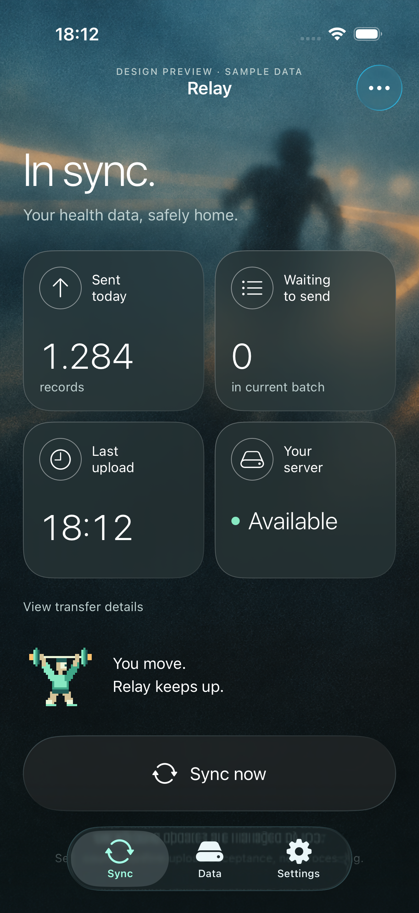
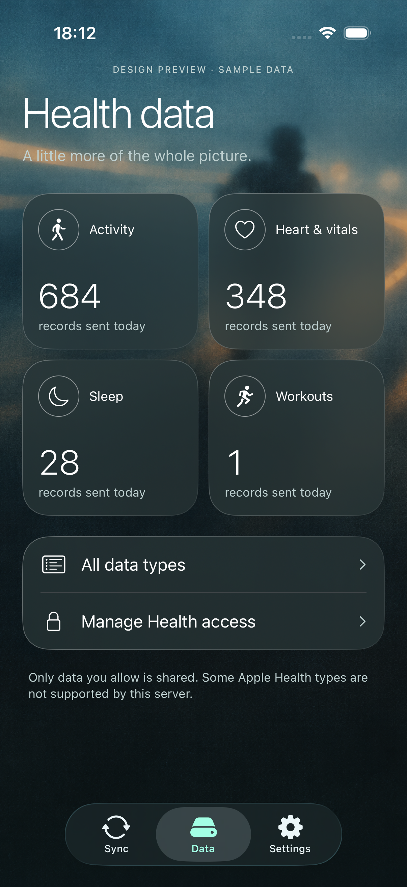
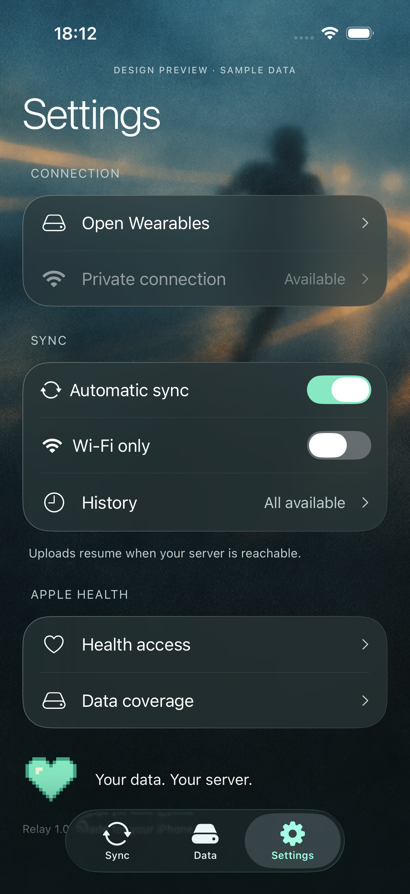

<p align="center">
  
</p>

<h1 align="center">Relay</h1>

<p align="center"><strong>Your health data. Your server.</strong></p>

<p align="center">Apple Health → Relay Hub<br>Native SwiftUI · iOS 26+ · Liquid Glass · Pixel art</p>

<p align="center">
  <a href="#get-started">Get started</a> ·
  <a href="server/README.md">Run Relay Hub</a> ·
  <a href="docs/COVERAGE.md">Health data coverage</a> ·
  <a href="server/README.md#connect-an-ai-assistant">Connect an AI assistant</a>
</p>

Relay sends the Apple Health records you choose to **Relay Hub**, a small server you run yourself. Explore your history, let your AI assistant read it over MCP, and have the assistant log meals back into Apple Health.

A smoky teal interface pairs native Liquid Glass controls with a mint pixel heart and athletes that cycle through gym, running, cycling and tennis.

## A look inside

<table>
  <tr>
    <th>Sync</th>
    <th>Health data</th>
    <th>Settings</th>
  </tr>
  <tr>
    <td></td>
    <td></td>
    <td></td>
  </tr>
</table>

*Actual iPhone Simulator screenshots from an earlier version. Every screen above uses demo mode and synthetic data; no personal health records or connection details are shown.*

## What Relay does

| Feature | How it works |
| --- | --- |
| Your server | Pair with your own Relay Hub over HTTPS using a one-time pairing code. Only a per-device token is stored on the iPhone. |
| Everything you allow | Every HealthKit quantity type, sleep stages, mindful sessions, stand hours, heart rate notifications, workouts and food entries. |
| Correct totals | Daily totals come from HealthKit's own statistics, so iPhone and Apple Watch are not counted twice. |
| Deletions mirrored | Records deleted in Apple Health are removed from Relay Hub too. |
| Resumable history | Import the last 30 days, the last year or everything in small batches, then pick up new records with anchored queries. |
| Automatic updates | Sync every 90 seconds while open and during background opportunities scheduled by iOS. |
| Connection recovery | Keep pending batches on the iPhone and retry when the hub is reachable. |
| AI meal logging | An assistant logs meals over MCP; Relay saves each one to Apple Health as a food entry. |
| Native interface | SwiftUI, Liquid Glass navigation, system controls, accessibility text sizes and Reduce Motion support. |

## Get started

You need **iOS 26+**, **Xcode 26+**, an always-on machine for [Relay Hub](server/README.md) that your iPhone can reach over HTTPS (for example on your tailnet), and an Apple signing team that supports the app's HealthKit entitlements. The source includes the generated Xcode project and has no external runtime packages.

1. Run Relay Hub on your server: see [the Relay Hub guide](server/README.md). Expose it with `tailscale serve` so it has an HTTPS `*.ts.net` address.
2. Open `Relay.xcodeproj` in Xcode 26 or newer (built here with Xcode 27).
3. Select the **Relay** target → **Signing & Capabilities** → choose your Apple development team. The HealthKit and background delivery entitlements are included. You need a signing team/provisioning profile that supports them.
4. Connect and unlock your iPhone running iOS 26 or newer. Enable Developer Mode when Xcode requests it. Select it as the run destination and Run.
5. On the server, run `docker compose exec relay-hub relay-hub pair-device`. In Relay, tap **Connect your Relay Hub**, enter the hub address and the one-time code.
6. Choose Health access and allow the types you want. The same sheet asks to write six nutrition types, used only for meals your assistant logs. Keep Relay open for the first import. Afterwards, HealthKit observer events and system-scheduled background tasks provide automatic opportunities to sync.

For a private local signing override, create the git-ignored `Config/Local.xcconfig` with the following settings. Keep your bundle identifier stable for updates so that existing app data and Keychain credentials remain accessible. Never put tokens or pairing codes there.

```xcconfig
DEVELOPMENT_TEAM = YOUR_TEAM_ID
RELAY_BUNDLE_IDENTIFIER = com.yourdomain.relay
```

## What syncs

- All 121 HealthKit quantity types in the iOS 27 SDK, generated from Apple's headers with their canonical units. Types newer than the device's iOS are skipped.
- Sleep stages, mindful sessions, stand hours, and high, low and irregular heart rate notifications.
- Workouts with their statistics and events, and food entries. See [coverage](docs/COVERAGE.md).
- HealthKit daily statistics for every changed day: sums for cumulative types, average/min/max for the rest.
- Incremental anchored queries, stable HealthKit UUIDs, source apps and devices, time zones, units, metadata and deletions.
- Durable, protected pending batches. A failed upload or failed local checkpoint write keeps the batch and its old anchor for retry.
- Automatic or manual sync, Wi-Fi-only transport restrictions, offline recovery and resumable history import.
- After granting more Health access or to import further back, use **Settings → History → Rescan**. The app preserves an unsent batch before allowing a rescan.

Not uploaded: clinical records, medications, ECG waveforms, audiograms, reproductive health and symptoms, state of mind, workout routes and high-frequency workout series.

Apple does not reveal denied read permissions. Empty results can mean no data or no access. Types Apple Health has not granted are listed under **Data coverage → Not shared with Relay**. iOS schedules background delivery; there is no permanently running service or guaranteed interval. Locked health data, system restrictions, force-quitting the app, and network reachability can delay uploads. Reopen Relay after force-quit.

## Relay Hub and your AI assistant

Relay Hub stores what Relay uploads in SQLite and serves it over MCP. Its tools let an assistant:

- list data types, and read daily summaries, raw samples, sleep nights and workouts;
- read nutrition totals and a food log;
- log, list and cancel meals.

Relay pulls queued meals on its next sync, saves each one to Apple Health with stable sync identifiers so retries never duplicate, and acknowledges it. Relay asks for write access only for dietary energy, protein, carbohydrates, total fat, fiber and sugar. See [the Relay Hub guide](server/README.md) for setup, MCP client configuration, the security model and the API.

## Development

There are no external runtime packages. XcodeGen is only needed when changing the project definition; the generated Xcode project is included.

```sh
xcodegen generate
xcodebuild -project Relay.xcodeproj -scheme Relay \
  -destination 'platform=iOS Simulator,name=iPhone 17 Pro' \
  -parallel-testing-enabled NO test
cd server && uv run pytest
```

Add `--demo` to the Xcode scheme’s launch arguments to view the approved design with explicit sample data. This mode does not pair, read HealthKit, save settings, or upload. Remove it for the actual app. The normal launch starts unpaired without fabricated statistics.

The decorative artwork beside “You move. Relay keeps up.” cycles through gym, running, cycling, and tennis, with four seconds per sport. It pauses offscreen or while inactive and shows a still pixel heart when **Reduce Motion** is enabled. The Settings footer also uses the heart. The background and icon are generated artwork; the athlete animations are drawn in code.

- `Relay/Core`: server validation, Keychain, Relay Hub client and protected checkpoint store.
- `Relay/Health`: generated catalog, HealthKit queries, statistics, payload mapping and meal writes.
- `Relay/Sync`: background scheduling and persisted upload/checkpoint lifecycle.
- `Relay/UI`: native tabs, design components, setup and status screens.
- `RelayTests`, `RelayUITests`: transfer, security, unit conversion, payload and navigation tests.
- `server`: Relay Hub (Python, FastMCP, SQLite, Docker).
- `scripts/build_catalog.py`: regenerates `Relay/Health/Catalog.json` and `docs/COVERAGE.md` from the HealthKit SDK headers.
- [Validation evidence](docs/VALIDATION.md).

The workout-name vocabulary is adapted under an MIT license; see [third-party notices](docs/THIRD-PARTY-NOTICES.md).

## Physical-device verification still required

After installation, pair your own hub, grant a small initial selection, and sync. Check the data with `list_data_types` and `get_daily_summary`. Then allow the remaining types, rescan history and validate background wakeups, locked-device recovery, Wi-Fi-only behavior and network reconnects. A successful simulator test is not evidence of these device behaviors.

## References

- [Apple HealthKit observer queries](https://developer.apple.com/documentation/healthkit/executing-observer-queries)
- [Apple HealthKit statistics collection queries](https://developer.apple.com/documentation/healthkit/hkstatisticscollectionquery)
- [Model Context Protocol](https://modelcontextprotocol.io)
- [Tailscale Serve](https://tailscale.com/kb/1312/serve)
- [Apple Liquid Glass](https://developer.apple.com/documentation/swiftui/applying-liquid-glass-to-custom-views)
